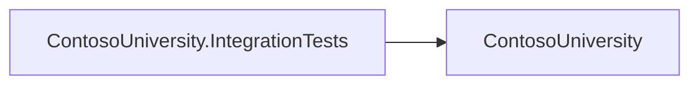

# Solution Baseline Report

| | |
|---|---|
| **Solution** | `C:\Users\tiago\Documents\Projetos\legacylens\TestLegacyProjects\ContosoUniversityDotNetCore\ContosoUniversity.sln` |
| **Run ID** | `20260924-043917-1b83b54f` |
| **Generated (UTC)** | 2026-09-24 04:39:26 |
| **Elapsed** | 8.4s (within the <5 min baseline milestone) |
| **Generated by** | LegacyLens Phase 1 (deterministic core) |

## Projects

| Project | Target Framework | Project Refs | Packages | Documents | Build |
|---|---|---:|---:|---:|---|
| ContosoUniversity | `netcoreapp2.0` | 0 | 9 | 59 | ✅ OK |
| ContosoUniversity.IntegrationTests | `netcoreapp2.0` | 1 | 9 | 24 | ✅ OK |

## Project Dependency Graph

## Complexity Hotspots (top 20 methods)

| Complexity | Method | Project |
|---:|---|---|
| 11 | `ContosoUniversity.Data.DbInitializer.Initialize(ContosoUniversity.Data.SchoolContext)` | ContosoUniversity |
| 10 | `ContosoUniversity.Features.Students.Index.QueryHandler.HandleCore(ContosoUniversity.Features.Students.Index.Query)` | ContosoUniversity |
| 6 | `ContosoUniversity.Models.Instructor.UpdateInstructorCourses(string[], System.Collections.Generic.IEnumerable<ContosoUniversity.Models.Course>)` | ContosoUniversity |
| 4 | `ContosoUniversity.Infrastructure.DbContextTransactionFilter.OnActionExecutionAsync(Microsoft.AspNetCore.Mvc.Filters.ActionExecutingContext, Microsoft.AspNetCore.Mvc.Filters.ActionExecutionDelegate)` | ContosoUniversity |
| 3 | `ContosoUniversity.Models.Instructor.UpdateDetails(ContosoUniversity.Features.Instructors.CreateEdit.Command)` | ContosoUniversity |
| 3 | `ContosoUniversity.Infrastructure.EntityModelBinder.BindModelAsync(Microsoft.AspNetCore.Mvc.ModelBinding.ModelBindingContext)` | ContosoUniversity |
| 3 | `ContosoUniversity.Infrastructure.ValidatorActionFilter.OnActionExecuting(Microsoft.AspNetCore.Mvc.Filters.ActionExecutingContext)` | ContosoUniversity |
| 3 | `ContosoUniversity.Infrastructure.Tags.EntitySelectElementBuilder<T>.Build(HtmlTags.Conventions.ElementRequest)` | ContosoUniversity |
| 3 | `ContosoUniversity.Features.HtmlHelperExtensions.FormBlock<T>(Microsoft.AspNetCore.Mvc.Rendering.IHtmlHelper<T>, System.Linq.Expressions.Expression<System.Func<T, object>>, System.Action<HtmlTags.HtmlTag>, System.Action<HtmlTags.HtmlTag>)` | ContosoUniversity |
| 3 | `ContosoUniversity.Features.Instructors.Index.Handler.HandleCore(ContosoUniversity.Features.Instructors.Index.Query)` | ContosoUniversity |
| 3 | `ContosoUniversity.Data.SchoolContext.CommitTransactionAsync()` | ContosoUniversity |
| 3 | `ContosoUniversity.IntegrationTests.IntegrationTestBase.InitializeAsync()` | ContosoUniversity.IntegrationTests |
| 2 | `ContosoUniversity.Program.Main(string[])` | ContosoUniversity |
| 2 | `ContosoUniversity.Startup.Configure(Microsoft.AspNetCore.Builder.IApplicationBuilder, Microsoft.AspNetCore.Hosting.IHostingEnvironment)` | ContosoUniversity |
| 2 | `ContosoUniversity.Infrastructure.EntityModelBinderProvider.GetBinder(Microsoft.AspNetCore.Mvc.ModelBinding.ModelBinderProviderContext)` | ContosoUniversity |
| 2 | `ContosoUniversity.Infrastructure.Tags.TagConventions.TagConventions()` | ContosoUniversity |
| 2 | `ContosoUniversity.Features.Instructors.CreateEdit.QueryHandler.HandleCore(ContosoUniversity.Features.Instructors.CreateEdit.Query)` | ContosoUniversity |
| 2 | `ContosoUniversity.Features.Instructors.CreateEdit.CommandHandler.HandleCore(ContosoUniversity.Features.Instructors.CreateEdit.Command)` | ContosoUniversity |
| 2 | `ContosoUniversity.Features.Instructors.Delete.CommandHandler.HandleCore(ContosoUniversity.Features.Instructors.Delete.Command)` | ContosoUniversity |
| 2 | `ContosoUniversity.Features.Home.HomeController.Error()` | ContosoUniversity |

## Deprecated Symbols ([Obsolete])

_No [Obsolete] symbols declared in source._

## AppCAT Incidents

Source: `contoso-appcat.json` — 6 incident(s), 14 story point(s) of estimated effort.

| Severity | Count |
|---|---:|
| Potential | 3 |
| Mandatory | 2 |
| Optional | 1 |

### Top Rules

| Rule | Severity | Incidents | Description |
|---|---|---:|---|
| `Runtime.0001` | Mandatory | 2 | Out of support .NET target framework is detected |
| `Configuration.0003` | Potential | 2 | Local application configuration detected |
| `Scale.0001` | Optional | 1 | Static content detected |
| `Connection.0001` | Potential | 1 | Connection string is detected |

## Organization Constraints

Policy: `example-constraints-policy.json` — Example Organization (illustrative policy used for validation testing) (schema v1, 6 rule(s)).

| Verdict | Rules |
|---|---:|
| ✅ Compliant | 1 |
| ❌ Non-compliant | 2 |
| 🔍 Requires human review | 2 |
| ➖ Not applicable | 1 |

| Rule | Kind | Verdict | Projects | Violations | Unresolved |
|---|---|---|---:|---:|---:|
| `TFM-001` Projects must target a supported .NET release | ApprovedTargetFrameworks | ❌ Non-compliant | 2 | 2 | 0 |
| `PKG-001` Legacy data-access and web stacks are prohibited | ProhibitedPackages | ✅ Compliant | 2 | 0 | 0 |
| `PKG-002` Dependencies with published advisories must meet a minimum version | MinimumPackageVersions | ❌ Non-compliant | 2 | 2 | 0 |
| `API-001` API projects must not depend on the legacy WCF stack | ProhibitedPackages | ➖ Not applicable | 0 | 0 | 0 |
| `SEC-001` Authentication must use OAuth 2.0 or OpenID Connect | ManualReview | 🔍 Requires human review | 2 | 0 | 2 |
| `ARCH-001` Layered architecture boundaries must be respected | Unsupported | 🔍 Requires human review | 2 | 0 | 1 |

### Findings

**`TFM-001` Projects must target a supported .NET release** — ❌ Non-compliant

_Releases outside this list no longer receive security fixes, so remaining on them carries unmitigated risk._

- ContosoUniversity — targets netcoreapp2.0, which is not an approved framework
- ContosoUniversity.IntegrationTests — targets netcoreapp2.0, which is not an approved framework

**`PKG-002` Dependencies with published advisories must meet a minimum version** — ❌ Non-compliant

_Versions below these carry published security advisories._

- ContosoUniversity — AutoMapper 6.2.1 is below the required minimum 10.0.0
- ContosoUniversity — Microsoft.AspNetCore.All 2.0.3 is below the required minimum 2.1.0

**`SEC-001` Authentication must use OAuth 2.0 or OpenID Connect** — 🔍 Requires human review

_Cannot be decided from dependency and symbol analysis alone; an engineer must verify the configured authentication flow._
_This requirement is not decidable from static analysis and must be verified by a person._

- ContosoUniversity — Confirm that the application authenticates through OAuth 2.0 or OpenID Connect rather than Forms Authentication.
- ContosoUniversity.IntegrationTests — Confirm that the application authenticates through OAuth 2.0 or OpenID Connect rather than Forms Authentication.

**`ARCH-001` Layered architecture boundaries must be respected** — 🔍 Requires human review

_Declared for a capability this version of the framework does not implement. It is reported as requiring human review rather than silently passing._
_Rule kind 'architecturalBoundaries' is not implemented in this version of the framework._

- (solution) — Rule kind 'architecturalBoundaries' is not implemented in this version of the framework.

## Workspace Load Diagnostics

5 non-fatal workspace diagnostic(s), 4 distinct:

- **(2x)** [Failure] Package 'Microsoft.NETCore.App' 2.0.0 has a known high severity vulnerability, https://github.com/advisories/GHSA-7mfr-774f-w5r9
- **(1x)** [Failure] Package 'AutoMapper' 6.2.1 has a known high severity vulnerability, https://github.com/advisories/GHSA-rvv3-g6hj-g44x
- **(1x)** [Failure] Package 'Microsoft.AspNetCore.All' 2.0.3 has a known moderate severity vulnerability, https://github.com/advisories/GHSA-3m2r-q8x3-xmf7
- **(1x)** [Failure] Package 'Microsoft.AspNetCore.All' 2.0.3 has a known moderate severity vulnerability, https://github.com/advisories/GHSA-cgpw-2gph-2r9g

