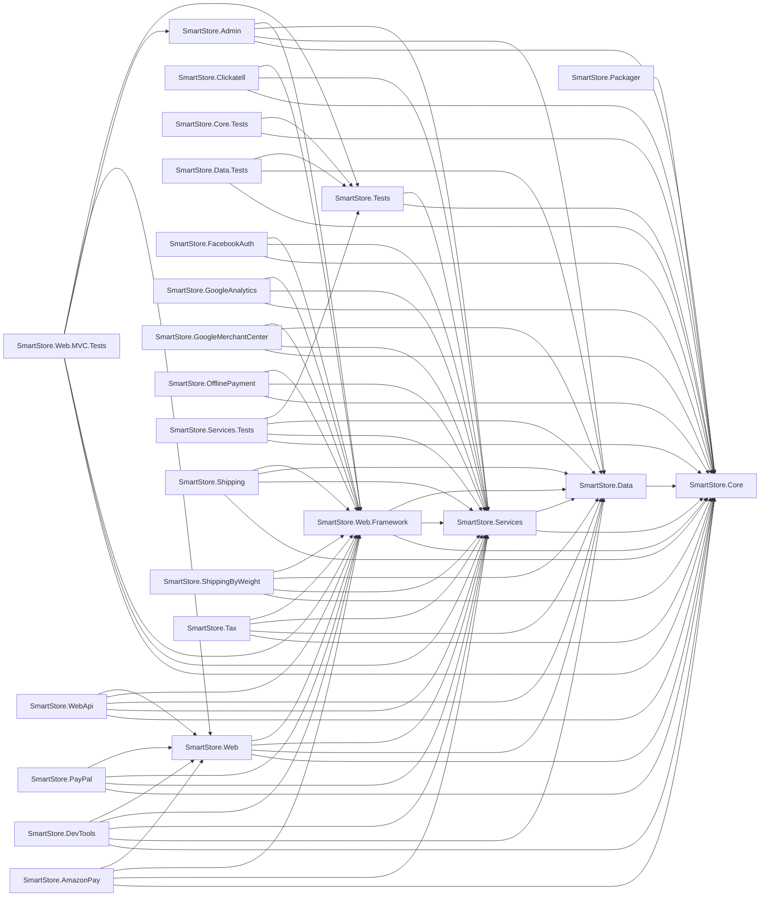

# Solution Baseline Report

| | |
|---|---|
| **Solution** | `C:\Users\tiago\Documents\Projetos\legacylens\TestLegacyProjects\SmartStoreNET\src\SmartStoreNET.sln` |
| **Run ID** | `20260924-043957-965bc810` |
| **Generated (UTC)** | 2026-09-24 04:40:46 |
| **Elapsed** | 48.0s (within the <5 min baseline milestone) |
| **Generated by** | LegacyLens Phase 1 (deterministic core) |

## Projects

| Project | Target Framework | Project Refs | Packages | Documents | Build |
|---|---|---:|---:|---:|---|
| SmartStore.Admin | `.NET Framework v4.7.2` | 4 | 21 | 233 | ✅ OK |
| SmartStore.AmazonPay | `.NET Framework v4.7.2` | 4 | 13 | 27 | ✅ OK |
| SmartStore.Clickatell | `.NET Framework v4.7.2` | 3 | 6 | 11 | ✅ OK |
| SmartStore.Core | `.NET Framework v4.7.2` | 0 | 18 | 630 | ✅ OK |
| SmartStore.Core.Tests | `.NET Framework v4.7.2` | 2 | 8 | 31 | ✅ OK |
| SmartStore.Data | `.NET Framework v4.7.2` | 1 | 9 | 369 | ✅ OK |
| SmartStore.Data.Tests | `.NET Framework v4.7.2` | 3 | 4 | 84 | ✅ OK |
| SmartStore.DevTools | `.NET Framework v4.7.2` | 5 | 19 | 28 | ✅ OK |
| SmartStore.FacebookAuth | `.NET Framework v4.7.2` | 3 | 20 | 15 | ✅ OK |
| SmartStore.GoogleAnalytics | `.NET Framework v4.7.2` | 3 | 5 | 10 | ✅ OK |
| SmartStore.GoogleMerchantCenter | `.NET Framework v4.7.2` | 4 | 13 | 30 | ✅ OK |
| SmartStore.OfflinePayment | `.NET Framework v4.7.2` | 3 | 11 | 18 | ✅ OK |
| SmartStore.Packager | `.NET Framework v4.7.2` | 1 | 0 | 12 | ✅ OK |
| SmartStore.PayPal | `.NET Framework v4.7.2` | 4 | 12 | 45 | ✅ OK |
| SmartStore.Services | `.NET Framework v4.7.2` | 2 | 27 | 583 | ✅ OK |
| SmartStore.Services.Tests | `.NET Framework v4.7.2` | 4 | 5 | 46 | ✅ OK |
| SmartStore.Shipping | `.NET Framework v4.7.2` | 4 | 11 | 23 | ✅ OK |
| SmartStore.ShippingByWeight | `.NET Framework v4.7.2` | 4 | 11 | 23 | ✅ OK |
| SmartStore.Tax | `.NET Framework v4.7.2` | 4 | 11 | 23 | ✅ OK |
| SmartStore.Tests | `.NET Framework v4.7.2` | 2 | 7 | 11 | ✅ OK |
| SmartStore.Web | `.NET Framework v4.7.2` | 4 | 41 | 189 | ✅ OK |
| SmartStore.Web.Framework | `.NET Framework v4.7.2` | 3 | 40 | 271 | ✅ OK |
| SmartStore.Web.MVC.Tests | `.NET Framework v4.7.2` | 6 | 8 | 33 | ✅ OK |
| SmartStore.WebApi | `.NET Framework v4.7.2` | 5 | 23 | 93 | ✅ OK |
| SmartStore.WebApi.Client | `.NET Framework v4.7.2` | 0 | 1 | 17 | ✅ OK |

## Project Dependency Graph

## Complexity Hotspots (top 20 methods)

| Complexity | Method | Project |
|---:|---|---|
| 174 | `SmartStore.Services.Search.LinqCatalogSearchService.GetProductQuery(SmartStore.Services.Search.CatalogSearchQuery, System.Linq.IQueryable<SmartStore.Core.Domain.Catalog.Product>)` | SmartStore.Services |
| 157 | `SmartStore.Web.Controllers.CatalogHelper.PrepareProductDetailModel(SmartStore.Web.Models.Catalog.ProductDetailsModel, SmartStore.Core.Domain.Catalog.Product, SmartStore.Services.Catalog.Modelling.ProductVariantQuery, bool, SmartStore.Core.Domain.Catalog.ProductBundleItemData, System.Collections.Generic.IList<SmartStore.Core.Domain.Catalog.ProductBundleItemData>, int)` | SmartStore.Web |
| 122 | `SmartStore.Services.Orders.OrderProcessingService.PlaceOrder(SmartStore.Services.Payments.ProcessPaymentRequest, System.Collections.Generic.Dictionary<string, string>)` | SmartStore.Services |
| 90 | `SmartStore.Data.Utilities.DataMigrator.AddRuleSets(SmartStore.Core.Data.IDbContext)` | SmartStore.Data |
| 69 | `SmartStore.TypeExtensions.IsCompatibleWith(System.Type, System.Type)` | SmartStore.Core |
| 66 | `SmartStore.Web.Controllers.ShoppingCartController.PrepareShoppingCartModel(SmartStore.Web.Models.ShoppingCart.ShoppingCartModel, System.Collections.Generic.IList<SmartStore.Core.Domain.Orders.OrganizedShoppingCartItem>, bool, bool, bool, bool, bool)` | SmartStore.Web |
| 64 | `SmartStore.Services.Search.LinqCatalogSearchService.GetFacets(SmartStore.Services.Search.CatalogSearchQuery, int)` | SmartStore.Services |
| 64 | `SmartStore.Services.Search.LinqForumSearchService.GetPostQuery(SmartStore.Services.Search.ForumSearchQuery, System.Linq.IQueryable<SmartStore.Core.Domain.Forums.ForumPost>)` | SmartStore.Services |
| 63 | `SmartStore.Services.DataExchange.Export.DataExporter.ToDynamic(SmartStore.Services.DataExchange.Export.Internal.DataExporterContext, SmartStore.Core.Domain.Catalog.Product, bool, SmartStore.Services.DataExchange.Export.DynamicProductContext)` | SmartStore.Services |
| 63 | `SmartStore.GoogleMerchantCenter.Providers.GmcXmlExportProvider.Export(SmartStore.Services.DataExchange.Export.ExportExecuteContext)` | SmartStore.GoogleMerchantCenter |
| 57 | `SmartStore.AmazonPay.Services.AmazonPayService.CreateViewModel(SmartStore.AmazonPay.Services.AmazonPayRequestType, System.Web.Mvc.TempDataDictionary)` | SmartStore.AmazonPay |
| 56 | `SmartStore.Web.Controllers.CatalogHelper.MapProductSummaryItem(SmartStore.Core.Domain.Catalog.Product, SmartStore.Web.Controllers.CatalogHelper.MapProductSummaryItemContext)` | SmartStore.Web |
| 56 | `SmartStore.Web.Framework.HtmlExtensions.IconForFileExtension(System.Web.Mvc.HtmlHelper, string, string, bool)` | SmartStore.Web.Framework |
| 52 | `SmartStore.Services.Rules.DefaultRuleOptionsProvider.GetOptions(SmartStore.Rules.RuleOptionsRequestReason, SmartStore.Rules.RuleDescriptor, string, int, int, string)` | SmartStore.Services |
| 52 | `SmartStore.Services.DataExchange.Export.DataExporter.DetachAllEntitiesAndClear(SmartStore.Services.DataExchange.Export.Internal.DataExporterContext)` | SmartStore.Services |
| 52 | `SmartStore.Services.DataExchange.Export.ExportXmlHelper.WriteProduct(dynamic, string)` | SmartStore.Services |
| 52 | `SmartStore.Web.Controllers.CustomerController.Register(SmartStore.Web.Models.Customer.RegisterModel, string, string)` | SmartStore.Web |
| 50 | `SmartStore.Services.Orders.OrderProcessingService.GetOrderPlacementWarnings(SmartStore.Services.Payments.ProcessPaymentRequest, SmartStore.Core.Domain.Orders.Order, SmartStore.Core.Domain.Customers.Customer, out System.Collections.Generic.IList<SmartStore.Core.Domain.Orders.OrganizedShoppingCartItem>)` | SmartStore.Services |
| 46 | `SmartStore.Linq.Expressions.ExpressionVisitor.Visit(System.Linq.Expressions.Expression)` | SmartStore.Core |
| 45 | `SmartStore.Services.Hooks.SearchQueryAliasHook.HookObject(SmartStore.Core.BaseEntity, SmartStore.Core.Data.Hooks.IHookedEntity)` | SmartStore.Services |

## Deprecated Symbols ([Obsolete])

17 symbol(s) marked [Obsolete]:

- `SmartStore.Data.EfRepository<T>.Expand(System.Linq.IQueryable<T>, string)` (SmartStore.Data)
- `SmartStore.Data.EfRepository<T>.Expand<TProperty>(System.Linq.IQueryable<T>, System.Linq.Expressions.Expression<System.Func<T, TProperty>>)` (SmartStore.Data)
- `SmartStore.StringExtensions.RemoveHtml(string, System.Collections.Generic.ICollection<string>)` (SmartStore.Core)
- `SmartStore.Guard.ArgumentNotNull(object, string)` (SmartStore.Core)
- `SmartStore.Guard.ArgumentNotNull<T>(System.Func<T>)` (SmartStore.Core)
- `SmartStore.Guard.ArgumentNotEmpty(System.Func<string>)` (SmartStore.Core)
- `SmartStore.Guard.ArgumentNotEmpty(string, string)` (SmartStore.Core)
- `SmartStore.Linq.PredicateBuilder.True<T>()` (SmartStore.Core)
- `SmartStore.Linq.PredicateBuilder.False<T>()` (SmartStore.Core)
- `SmartStore.Core.Html.HtmlUtils.FormatText(string, bool, bool, bool, bool, bool, bool)` (SmartStore.Core)
- `SmartStore.Core.Configuration.JsonPersistAttribute` (SmartStore.Core)
- `SmartStore.Core.Events.IConsumer<T>` (SmartStore.Core)
- `SmartStore.Core.Data.IRepository<T>.Expand(System.Linq.IQueryable<T>, string)` (SmartStore.Core)
- `SmartStore.Core.Data.IRepository<T>.Expand<TProperty>(System.Linq.IQueryable<T>, System.Linq.Expressions.Expression<System.Func<T, TProperty>>)` (SmartStore.Core)
- `SmartStore.Web.Framework.WebWorkContext.IsPublishedLanguage(string, int)` (SmartStore.Web.Framework)
- `SmartStore.Web.Framework.WebWorkContext.GetDefaultLanguageSeoCode(int)` (SmartStore.Web.Framework)
- `SmartStore.Web.Framework.UI.ScaffoldExtensions.RichEditorFlavor(System.Web.Mvc.HtmlHelper)` (SmartStore.Web.Framework)

## AppCAT Incidents

Source: `smartstore-appcat.json` — 1060 incident(s), 2794 story point(s) of estimated effort.

| Severity | Count |
|---|---:|
| Potential | 712 |
| Optional | 333 |
| Mandatory | 15 |

### Top Rules

| Rule | Severity | Incidents | Description |
|---|---|---:|---|
| `Local.0003` | Potential | 469 | Local or network IO operations detected |
| `Security.0003` | Optional | 190 | Hardcoded sensitive data detected |
| `Local.0006` | Potential | 137 | Hardcoded URLs detected |
| `Perf.0001` | Optional | 47 | Synchronous API usage detected |
| `HTTP.0001` | Potential | 46 | Access to external resources via HTTP is detected |
| `SMTP.0001` | Potential | 33 | SMTP connections detected |
| `Database.0003` | Optional | 29 | System.Data.SqlClient dependency detected |
| `Logging.0103` | Optional | 29 | Log4Net logging framework detected |
| `Scale.0001` | Optional | 11 | Static content detected |
| `Cache.0001` | Potential | 8 | Data caching is detected |

## Organization Constraints

Policy: `example-constraints-policy.json` — Example Organization (illustrative policy used for validation testing) (schema v1, 6 rule(s)).

| Verdict | Rules |
|---|---:|
| ✅ Compliant | 1 |
| ❌ Non-compliant | 3 |
| 🔍 Requires human review | 2 |
| ➖ Not applicable | 0 |

| Rule | Kind | Verdict | Projects | Violations | Unresolved |
|---|---|---|---:|---:|---:|
| `TFM-001` Projects must target a supported .NET release | ApprovedTargetFrameworks | ❌ Non-compliant | 25 | 25 | 0 |
| `PKG-001` Legacy data-access and web stacks are prohibited | ProhibitedPackages | ❌ Non-compliant | 25 | 52 | 0 |
| `PKG-002` Dependencies with published advisories must meet a minimum version | MinimumPackageVersions | ❌ Non-compliant | 25 | 17 | 0 |
| `API-001` API projects must not depend on the legacy WCF stack | ProhibitedPackages | ✅ Compliant | 1 | 0 | 0 |
| `SEC-001` Authentication must use OAuth 2.0 or OpenID Connect | ManualReview | 🔍 Requires human review | 25 | 0 | 25 |
| `ARCH-001` Layered architecture boundaries must be respected | Unsupported | 🔍 Requires human review | 25 | 0 | 1 |

### Findings

**`TFM-001` Projects must target a supported .NET release** — ❌ Non-compliant

_Releases outside this list no longer receive security fixes, so remaining on them carries unmitigated risk._

- SmartStore.Admin — targets .NET Framework v4.7.2, which is not an approved framework
- SmartStore.AmazonPay — targets .NET Framework v4.7.2, which is not an approved framework
- SmartStore.Clickatell — targets .NET Framework v4.7.2, which is not an approved framework
- SmartStore.Core — targets .NET Framework v4.7.2, which is not an approved framework
- SmartStore.Core.Tests — targets .NET Framework v4.7.2, which is not an approved framework
- SmartStore.Data — targets .NET Framework v4.7.2, which is not an approved framework
- SmartStore.Data.Tests — targets .NET Framework v4.7.2, which is not an approved framework
- SmartStore.DevTools — targets .NET Framework v4.7.2, which is not an approved framework
- SmartStore.FacebookAuth — targets .NET Framework v4.7.2, which is not an approved framework
- SmartStore.GoogleAnalytics — targets .NET Framework v4.7.2, which is not an approved framework
- _...and 15 more_

**`PKG-001` Legacy data-access and web stacks are prohibited** — ❌ Non-compliant

_These packages are tied to .NET Framework and block migration to a supported runtime._

- SmartStore.Admin — references prohibited package EntityFramework 6.4.4
- SmartStore.Admin — references prohibited package Microsoft.AspNet.Mvc 5.2.7
- SmartStore.Admin — references prohibited package Microsoft.AspNet.WebPages 3.2.7
- SmartStore.AmazonPay — references prohibited package Microsoft.AspNet.Mvc 5.2.7
- SmartStore.AmazonPay — references prohibited package Microsoft.AspNet.WebPages 3.2.7
- SmartStore.Clickatell — references prohibited package Microsoft.AspNet.Mvc 5.2.7
- SmartStore.Clickatell — references prohibited package Microsoft.AspNet.WebPages 3.2.7
- SmartStore.Core — references prohibited package EntityFramework 6.4.4
- SmartStore.Core — references prohibited package Microsoft.AspNet.Mvc 5.2.7
- SmartStore.Core — references prohibited package Microsoft.AspNet.WebPages 3.2.7
- _...and 42 more_

**`PKG-002` Dependencies with published advisories must meet a minimum version** — ❌ Non-compliant

_Versions below these carry published security advisories._

- SmartStore.Admin — Newtonsoft.Json 12.0.3 is below the required minimum 13.0.1
- SmartStore.AmazonPay — Newtonsoft.Json 12.0.3 is below the required minimum 13.0.1
- SmartStore.Clickatell — Newtonsoft.Json 12.0.3 is below the required minimum 13.0.1
- SmartStore.Core — Newtonsoft.Json 12.0.3 is below the required minimum 13.0.1
- SmartStore.Core.Tests — Newtonsoft.Json 12.0.3 is below the required minimum 13.0.1
- SmartStore.Data — Newtonsoft.Json 12.0.3 is below the required minimum 13.0.1
- SmartStore.DevTools — Newtonsoft.Json 12.0.3 is below the required minimum 13.0.1
- SmartStore.FacebookAuth — Newtonsoft.Json 12.0.3 is below the required minimum 13.0.1
- SmartStore.GoogleMerchantCenter — Newtonsoft.Json 12.0.3 is below the required minimum 13.0.1
- SmartStore.OfflinePayment — Newtonsoft.Json 12.0.3 is below the required minimum 13.0.1
- _...and 7 more_

**`SEC-001` Authentication must use OAuth 2.0 or OpenID Connect** — 🔍 Requires human review

_Cannot be decided from dependency and symbol analysis alone; an engineer must verify the configured authentication flow._
_This requirement is not decidable from static analysis and must be verified by a person._

- SmartStore.Admin — Confirm that the application authenticates through OAuth 2.0 or OpenID Connect rather than Forms Authentication.
- SmartStore.AmazonPay — Confirm that the application authenticates through OAuth 2.0 or OpenID Connect rather than Forms Authentication.
- SmartStore.Clickatell — Confirm that the application authenticates through OAuth 2.0 or OpenID Connect rather than Forms Authentication.
- SmartStore.Core — Confirm that the application authenticates through OAuth 2.0 or OpenID Connect rather than Forms Authentication.
- SmartStore.Core.Tests — Confirm that the application authenticates through OAuth 2.0 or OpenID Connect rather than Forms Authentication.
- SmartStore.Data — Confirm that the application authenticates through OAuth 2.0 or OpenID Connect rather than Forms Authentication.
- SmartStore.Data.Tests — Confirm that the application authenticates through OAuth 2.0 or OpenID Connect rather than Forms Authentication.
- SmartStore.DevTools — Confirm that the application authenticates through OAuth 2.0 or OpenID Connect rather than Forms Authentication.
- SmartStore.FacebookAuth — Confirm that the application authenticates through OAuth 2.0 or OpenID Connect rather than Forms Authentication.
- SmartStore.GoogleAnalytics — Confirm that the application authenticates through OAuth 2.0 or OpenID Connect rather than Forms Authentication.
- _...and 15 more_

**`ARCH-001` Layered architecture boundaries must be respected** — 🔍 Requires human review

_Declared for a capability this version of the framework does not implement. It is reported as requiring human review rather than silently passing._
_Rule kind 'architecturalBoundaries' is not implemented in this version of the framework._

- (solution) — Rule kind 'architecturalBoundaries' is not implemented in this version of the framework.

## Workspace Load Diagnostics

6 non-fatal workspace diagnostic(s), 6 distinct:

- **(1x)** [Warning] Found project reference without a matching metadata reference: C:\Users\tiago\Documents\Projetos\legacylens\TestLegacyProjects\SmartStoreNET\src\Libraries\SmartStore.Core\SmartStore.Core.csproj
- **(1x)** [Warning] Found project reference without a matching metadata reference: C:\Users\tiago\Documents\Projetos\legacylens\TestLegacyProjects\SmartStoreNET\src\Libraries\SmartStore.Data\SmartStore.Data.csproj
- **(1x)** [Warning] Found project reference without a matching metadata reference: C:\Users\tiago\Documents\Projetos\legacylens\TestLegacyProjects\SmartStoreNET\src\Tests\SmartStore.Tests\SmartStore.Tests.csproj
- **(1x)** [Warning] Found project reference without a matching metadata reference: C:\Users\tiago\Documents\Projetos\legacylens\TestLegacyProjects\SmartStoreNET\src\Presentation\SmartStore.Web.Framework\SmartStore.Web.Framework.csproj
- **(1x)** [Warning] Found project reference without a matching metadata reference: C:\Users\tiago\Documents\Projetos\legacylens\TestLegacyProjects\SmartStoreNET\src\Presentation\SmartStore.Web\Administration\SmartStore.Admin.csproj
- **(1x)** [Warning] Found project reference without a matching metadata reference: C:\Users\tiago\Documents\Projetos\legacylens\TestLegacyProjects\SmartStoreNET\src\Presentation\SmartStore.Web\SmartStore.Web.csproj

