# Solution Baseline Report

| | |
|---|---|
| **Solution** | `.\TestLegacyProjects\nopCommerce\src\NopCommerce.sln` |
| **Run ID** | `20260803-021405-873907fe` |
| **Generated (UTC)** | 2026-08-03 02:14:22 |
| **Elapsed** | 16.2s (within the <5 min baseline milestone) |
| **Generated by** | LegacyLens Phase 1 (deterministic core) |

## Projects

| Project | Target Framework | Project Refs | Packages | Documents | Build |
|---|---|---:|---:|---:|---|
| Nop.Admin | `.NET Framework v4.5.1` | 4 | 15 | 278 | ✅ OK |
| Nop.Core | `.NET Framework v4.5.1` | 0 | 10 | 291 | ✅ OK |
| Nop.Core.Tests | `.NET Framework v4.5.1` | 2 | 7 | 25 | ✅ OK |
| Nop.Data | `.NET Framework v4.5.1` | 1 | 3 | 124 | ✅ OK |
| Nop.Data.Tests | `.NET Framework v4.5.1` | 3 | 4 | 100 | ✅ OK |
| Nop.Plugin.DiscountRules.CustomerRoles | `.NET Framework v4.5.1` | 3 | 8 | 6 | ✅ OK |
| Nop.Plugin.DiscountRules.HasOneProduct | `.NET Framework v4.5.1` | 3 | 8 | 6 | ✅ OK |
| Nop.Plugin.ExchangeRate.EcbExchange | `.NET Framework v4.5.1` | 2 | 8 | 3 | ✅ OK |
| Nop.Plugin.ExternalAuth.Facebook | `.NET Framework v4.5.1` | 3 | 16 | 13 | ✅ OK |
| Nop.Plugin.Feed.GoogleShopping | `.NET Framework v4.5.1` | 4 | 10 | 13 | ✅ OK |
| Nop.Plugin.Payments.CheckMoneyOrder | `.NET Framework v4.5.1` | 3 | 8 | 7 | ✅ OK |
| Nop.Plugin.Payments.Manual | `.NET Framework v4.5.1` | 3 | 9 | 9 | ✅ OK |
| Nop.Plugin.Payments.PayPalDirect | `.NET Framework v4.5.1` | 3 | 11 | 11 | ✅ OK |
| Nop.Plugin.Payments.PayPalStandard | `.NET Framework v4.5.1` | 3 | 8 | 8 | ✅ OK |
| Nop.Plugin.Payments.PurchaseOrder | `.NET Framework v4.5.1` | 3 | 8 | 8 | ✅ OK |
| Nop.Plugin.Pickup.PickupInStore | `.NET Framework v4.5.1` | 4 | 10 | 13 | ✅ OK |
| Nop.Plugin.Shipping.AustraliaPost | `.NET Framework v4.5.1` | 3 | 9 | 7 | ✅ OK |
| Nop.Plugin.Shipping.CanadaPost | `.NET Framework v4.5.1` | 3 | 8 | 12 | ✅ OK |
| Nop.Plugin.Shipping.Fedex | `.NET Framework v4.5.1` | 3 | 8 | 13 | ✅ OK |
| Nop.Plugin.Shipping.FixedOrByWeight | `.NET Framework v4.5.1` | 4 | 10 | 16 | ✅ OK |
| Nop.Plugin.Shipping.UPS | `.NET Framework v4.5.1` | 3 | 8 | 14 | ✅ OK |
| Nop.Plugin.Shipping.USPS | `.NET Framework v4.5.1` | 3 | 8 | 9 | ✅ OK |
| Nop.Plugin.Tax.FixedOrByCountryStateZip | `.NET Framework v4.5.1` | 4 | 10 | 18 | ✅ OK |
| Nop.Plugin.Widgets.GoogleAnalytics | `.NET Framework v4.5.1` | 3 | 8 | 6 | ✅ OK |
| Nop.Plugin.Widgets.NivoSlider | `.NET Framework v4.5.1` | 3 | 9 | 9 | ✅ OK |
| Nop.Services | `.NET Framework v4.5.1` | 2 | 28 | 321 | ✅ OK |
| Nop.Services.Tests | `.NET Framework v4.5.1` | 4 | 13 | 41 | ✅ OK |
| Nop.Tests | `.NET Framework v4.5.1` | 1 | 2 | 7 | ✅ OK |
| Nop.Web | `.NET Framework v4.5.1` | 4 | 43 | 232 | ✅ OK |
| Nop.Web.Framework | `.NET Framework v4.5.1` | 3 | 18 | 105 | ✅ OK |
| Nop.Web.MVC.Tests | `.NET Framework v4.5.1` | 7 | 13 | 36 | ✅ OK |

## Project Dependency Graph

```mermaid
graph LR
    Nop_Admin["Nop.Admin"] --> Nop_Core["Nop.Core"]
    Nop_Admin["Nop.Admin"] --> Nop_Data["Nop.Data"]
    Nop_Admin["Nop.Admin"] --> Nop_Services["Nop.Services"]
    Nop_Admin["Nop.Admin"] --> Nop_Web_Framework["Nop.Web.Framework"]
    Nop_Core_Tests["Nop.Core.Tests"] --> Nop_Core["Nop.Core"]
    Nop_Core_Tests["Nop.Core.Tests"] --> Nop_Tests["Nop.Tests"]
    Nop_Data["Nop.Data"] --> Nop_Core["Nop.Core"]
    Nop_Data_Tests["Nop.Data.Tests"] --> Nop_Core["Nop.Core"]
    Nop_Data_Tests["Nop.Data.Tests"] --> Nop_Data["Nop.Data"]
    Nop_Data_Tests["Nop.Data.Tests"] --> Nop_Tests["Nop.Tests"]
    Nop_Plugin_DiscountRules_CustomerRoles["Nop.Plugin.DiscountRules.CustomerRoles"] --> Nop_Core["Nop.Core"]
    Nop_Plugin_DiscountRules_CustomerRoles["Nop.Plugin.DiscountRules.CustomerRoles"] --> Nop_Services["Nop.Services"]
    Nop_Plugin_DiscountRules_CustomerRoles["Nop.Plugin.DiscountRules.CustomerRoles"] --> Nop_Web_Framework["Nop.Web.Framework"]
    Nop_Plugin_DiscountRules_HasOneProduct["Nop.Plugin.DiscountRules.HasOneProduct"] --> Nop_Core["Nop.Core"]
    Nop_Plugin_DiscountRules_HasOneProduct["Nop.Plugin.DiscountRules.HasOneProduct"] --> Nop_Services["Nop.Services"]
    Nop_Plugin_DiscountRules_HasOneProduct["Nop.Plugin.DiscountRules.HasOneProduct"] --> Nop_Web_Framework["Nop.Web.Framework"]
    Nop_Plugin_ExchangeRate_EcbExchange["Nop.Plugin.ExchangeRate.EcbExchange"] --> Nop_Core["Nop.Core"]
    Nop_Plugin_ExchangeRate_EcbExchange["Nop.Plugin.ExchangeRate.EcbExchange"] --> Nop_Services["Nop.Services"]
    Nop_Plugin_ExternalAuth_Facebook["Nop.Plugin.ExternalAuth.Facebook"] --> Nop_Core["Nop.Core"]
    Nop_Plugin_ExternalAuth_Facebook["Nop.Plugin.ExternalAuth.Facebook"] --> Nop_Services["Nop.Services"]
    Nop_Plugin_ExternalAuth_Facebook["Nop.Plugin.ExternalAuth.Facebook"] --> Nop_Web_Framework["Nop.Web.Framework"]
    Nop_Plugin_Feed_GoogleShopping["Nop.Plugin.Feed.GoogleShopping"] --> Nop_Core["Nop.Core"]
    Nop_Plugin_Feed_GoogleShopping["Nop.Plugin.Feed.GoogleShopping"] --> Nop_Data["Nop.Data"]
    Nop_Plugin_Feed_GoogleShopping["Nop.Plugin.Feed.GoogleShopping"] --> Nop_Services["Nop.Services"]
    Nop_Plugin_Feed_GoogleShopping["Nop.Plugin.Feed.GoogleShopping"] --> Nop_Web_Framework["Nop.Web.Framework"]
    Nop_Plugin_Payments_CheckMoneyOrder["Nop.Plugin.Payments.CheckMoneyOrder"] --> Nop_Core["Nop.Core"]
    Nop_Plugin_Payments_CheckMoneyOrder["Nop.Plugin.Payments.CheckMoneyOrder"] --> Nop_Services["Nop.Services"]
    Nop_Plugin_Payments_CheckMoneyOrder["Nop.Plugin.Payments.CheckMoneyOrder"] --> Nop_Web_Framework["Nop.Web.Framework"]
    Nop_Plugin_Payments_Manual["Nop.Plugin.Payments.Manual"] --> Nop_Core["Nop.Core"]
    Nop_Plugin_Payments_Manual["Nop.Plugin.Payments.Manual"] --> Nop_Services["Nop.Services"]
    Nop_Plugin_Payments_Manual["Nop.Plugin.Payments.Manual"] --> Nop_Web_Framework["Nop.Web.Framework"]
    Nop_Plugin_Payments_PayPalDirect["Nop.Plugin.Payments.PayPalDirect"] --> Nop_Core["Nop.Core"]
    Nop_Plugin_Payments_PayPalDirect["Nop.Plugin.Payments.PayPalDirect"] --> Nop_Services["Nop.Services"]
    Nop_Plugin_Payments_PayPalDirect["Nop.Plugin.Payments.PayPalDirect"] --> Nop_Web_Framework["Nop.Web.Framework"]
    Nop_Plugin_Payments_PayPalStandard["Nop.Plugin.Payments.PayPalStandard"] --> Nop_Core["Nop.Core"]
    Nop_Plugin_Payments_PayPalStandard["Nop.Plugin.Payments.PayPalStandard"] --> Nop_Services["Nop.Services"]
    Nop_Plugin_Payments_PayPalStandard["Nop.Plugin.Payments.PayPalStandard"] --> Nop_Web_Framework["Nop.Web.Framework"]
    Nop_Plugin_Payments_PurchaseOrder["Nop.Plugin.Payments.PurchaseOrder"] --> Nop_Core["Nop.Core"]
    Nop_Plugin_Payments_PurchaseOrder["Nop.Plugin.Payments.PurchaseOrder"] --> Nop_Services["Nop.Services"]
    Nop_Plugin_Payments_PurchaseOrder["Nop.Plugin.Payments.PurchaseOrder"] --> Nop_Web_Framework["Nop.Web.Framework"]
    Nop_Plugin_Pickup_PickupInStore["Nop.Plugin.Pickup.PickupInStore"] --> Nop_Core["Nop.Core"]
    Nop_Plugin_Pickup_PickupInStore["Nop.Plugin.Pickup.PickupInStore"] --> Nop_Data["Nop.Data"]
    Nop_Plugin_Pickup_PickupInStore["Nop.Plugin.Pickup.PickupInStore"] --> Nop_Services["Nop.Services"]
    Nop_Plugin_Pickup_PickupInStore["Nop.Plugin.Pickup.PickupInStore"] --> Nop_Web_Framework["Nop.Web.Framework"]
    Nop_Plugin_Shipping_AustraliaPost["Nop.Plugin.Shipping.AustraliaPost"] --> Nop_Core["Nop.Core"]
    Nop_Plugin_Shipping_AustraliaPost["Nop.Plugin.Shipping.AustraliaPost"] --> Nop_Services["Nop.Services"]
    Nop_Plugin_Shipping_AustraliaPost["Nop.Plugin.Shipping.AustraliaPost"] --> Nop_Web_Framework["Nop.Web.Framework"]
    Nop_Plugin_Shipping_CanadaPost["Nop.Plugin.Shipping.CanadaPost"] --> Nop_Core["Nop.Core"]
    Nop_Plugin_Shipping_CanadaPost["Nop.Plugin.Shipping.CanadaPost"] --> Nop_Services["Nop.Services"]
    Nop_Plugin_Shipping_CanadaPost["Nop.Plugin.Shipping.CanadaPost"] --> Nop_Web_Framework["Nop.Web.Framework"]
    Nop_Plugin_Shipping_Fedex["Nop.Plugin.Shipping.Fedex"] --> Nop_Core["Nop.Core"]
    Nop_Plugin_Shipping_Fedex["Nop.Plugin.Shipping.Fedex"] --> Nop_Services["Nop.Services"]
    Nop_Plugin_Shipping_Fedex["Nop.Plugin.Shipping.Fedex"] --> Nop_Web_Framework["Nop.Web.Framework"]
    Nop_Plugin_Shipping_FixedOrByWeight["Nop.Plugin.Shipping.FixedOrByWeight"] --> Nop_Core["Nop.Core"]
    Nop_Plugin_Shipping_FixedOrByWeight["Nop.Plugin.Shipping.FixedOrByWeight"] --> Nop_Data["Nop.Data"]
    Nop_Plugin_Shipping_FixedOrByWeight["Nop.Plugin.Shipping.FixedOrByWeight"] --> Nop_Services["Nop.Services"]
    Nop_Plugin_Shipping_FixedOrByWeight["Nop.Plugin.Shipping.FixedOrByWeight"] --> Nop_Web_Framework["Nop.Web.Framework"]
    Nop_Plugin_Shipping_UPS["Nop.Plugin.Shipping.UPS"] --> Nop_Core["Nop.Core"]
    Nop_Plugin_Shipping_UPS["Nop.Plugin.Shipping.UPS"] --> Nop_Services["Nop.Services"]
    Nop_Plugin_Shipping_UPS["Nop.Plugin.Shipping.UPS"] --> Nop_Web_Framework["Nop.Web.Framework"]
    Nop_Plugin_Shipping_USPS["Nop.Plugin.Shipping.USPS"] --> Nop_Core["Nop.Core"]
    Nop_Plugin_Shipping_USPS["Nop.Plugin.Shipping.USPS"] --> Nop_Services["Nop.Services"]
    Nop_Plugin_Shipping_USPS["Nop.Plugin.Shipping.USPS"] --> Nop_Web_Framework["Nop.Web.Framework"]
    Nop_Plugin_Tax_FixedOrByCountryStateZip["Nop.Plugin.Tax.FixedOrByCountryStateZip"] --> Nop_Core["Nop.Core"]
    Nop_Plugin_Tax_FixedOrByCountryStateZip["Nop.Plugin.Tax.FixedOrByCountryStateZip"] --> Nop_Data["Nop.Data"]
    Nop_Plugin_Tax_FixedOrByCountryStateZip["Nop.Plugin.Tax.FixedOrByCountryStateZip"] --> Nop_Services["Nop.Services"]
    Nop_Plugin_Tax_FixedOrByCountryStateZip["Nop.Plugin.Tax.FixedOrByCountryStateZip"] --> Nop_Web_Framework["Nop.Web.Framework"]
    Nop_Plugin_Widgets_GoogleAnalytics["Nop.Plugin.Widgets.GoogleAnalytics"] --> Nop_Core["Nop.Core"]
    Nop_Plugin_Widgets_GoogleAnalytics["Nop.Plugin.Widgets.GoogleAnalytics"] --> Nop_Services["Nop.Services"]
    Nop_Plugin_Widgets_GoogleAnalytics["Nop.Plugin.Widgets.GoogleAnalytics"] --> Nop_Web_Framework["Nop.Web.Framework"]
    Nop_Plugin_Widgets_NivoSlider["Nop.Plugin.Widgets.NivoSlider"] --> Nop_Core["Nop.Core"]
    Nop_Plugin_Widgets_NivoSlider["Nop.Plugin.Widgets.NivoSlider"] --> Nop_Services["Nop.Services"]
    Nop_Plugin_Widgets_NivoSlider["Nop.Plugin.Widgets.NivoSlider"] --> Nop_Web_Framework["Nop.Web.Framework"]
    Nop_Services["Nop.Services"] --> Nop_Core["Nop.Core"]
    Nop_Services["Nop.Services"] --> Nop_Data["Nop.Data"]
    Nop_Services_Tests["Nop.Services.Tests"] --> Nop_Core["Nop.Core"]
    Nop_Services_Tests["Nop.Services.Tests"] --> Nop_Data["Nop.Data"]
    Nop_Services_Tests["Nop.Services.Tests"] --> Nop_Services["Nop.Services"]
    Nop_Services_Tests["Nop.Services.Tests"] --> Nop_Tests["Nop.Tests"]
    Nop_Tests["Nop.Tests"] --> Nop_Core["Nop.Core"]
    Nop_Web["Nop.Web"] --> Nop_Core["Nop.Core"]
    Nop_Web["Nop.Web"] --> Nop_Data["Nop.Data"]
    Nop_Web["Nop.Web"] --> Nop_Services["Nop.Services"]
    Nop_Web["Nop.Web"] --> Nop_Web_Framework["Nop.Web.Framework"]
    Nop_Web_Framework["Nop.Web.Framework"] --> Nop_Core["Nop.Core"]
    Nop_Web_Framework["Nop.Web.Framework"] --> Nop_Data["Nop.Data"]
    Nop_Web_Framework["Nop.Web.Framework"] --> Nop_Services["Nop.Services"]
    Nop_Web_MVC_Tests["Nop.Web.MVC.Tests"] --> Nop_Core["Nop.Core"]
    Nop_Web_MVC_Tests["Nop.Web.MVC.Tests"] --> Nop_Data["Nop.Data"]
    Nop_Web_MVC_Tests["Nop.Web.MVC.Tests"] --> Nop_Services["Nop.Services"]
    Nop_Web_MVC_Tests["Nop.Web.MVC.Tests"] --> Nop_Web_Framework["Nop.Web.Framework"]
    Nop_Web_MVC_Tests["Nop.Web.MVC.Tests"] --> Nop_Admin["Nop.Admin"]
    Nop_Web_MVC_Tests["Nop.Web.MVC.Tests"] --> Nop_Web["Nop.Web"]
    Nop_Web_MVC_Tests["Nop.Web.MVC.Tests"] --> Nop_Tests["Nop.Tests"]
```

## Complexity Hotspots (top 20 methods)

| Complexity | Method | Project |
|---:|---|---|
| 163 | `Nop.Services.ExportImport.ImportManager.ImportProductsFromXlsx(System.IO.Stream)` | Nop.Services |
| 110 | `Nop.Services.Common.PdfService.PrintOrdersToPdf(System.IO.Stream, System.Collections.Generic.IList<Nop.Core.Domain.Orders.Order>, int, int)` | Nop.Services |
| 101 | `Nop.Services.Catalog.ProductService.SearchProducts(out System.Collections.Generic.IList<int>, bool, int, int, System.Collections.Generic.IList<int>, int, int, int, int, Nop.Core.Domain.Catalog.ProductType?, bool, bool, bool?, decimal?, decimal?, int, string, bool, bool, bool, bool, int, System.Collections.Generic.IList<int>, Nop.Core.Domain.Catalog.ProductSortingEnum, bool, bool?)` | Nop.Services |
| 69 | `Nop.Services.Orders.OrderTotalCalculationService.UpdateOrderTotals(Nop.Services.Orders.UpdateOrderParameters, System.Collections.Generic.IList<Nop.Core.Domain.Orders.ShoppingCartItem>)` | Nop.Services |
| 56 | `Nop.Admin.Controllers.CustomerController.Edit(Nop.Admin.Models.Customers.CustomerModel, bool, System.Web.Mvc.FormCollection)` | Nop.Admin |
| 52 | `Nop.Plugin.Shipping.CanadaPost.CanadaPostComputationMethod.GetShippingOptions(Nop.Services.Shipping.GetShippingOptionRequest)` | Nop.Plugin.Shipping.CanadaPost |
| 49 | `Nop.Services.Catalog.CopyProductService.CopyProduct(Nop.Core.Domain.Catalog.Product, string, bool, bool, bool)` | Nop.Services |
| 46 | `Nop.Admin.Controllers.CustomerController.Create(Nop.Admin.Models.Customers.CustomerModel, bool, System.Web.Mvc.FormCollection)` | Nop.Admin |
| 46 | `Nop.Plugin.Feed.GoogleShopping.GoogleShoppingService.GenerateFeed(System.IO.Stream, Nop.Core.Domain.Stores.Store)` | Nop.Plugin.Feed.GoogleShopping |
| 45 | `Nop.Web.Controllers.CustomerController.Register(Nop.Web.Models.Customer.RegisterModel, string, bool, System.Web.Mvc.FormCollection)` | Nop.Web |
| 44 | `Nop.Web.Controllers.ShoppingCartController.ParseProductAttributes(Nop.Core.Domain.Catalog.Product, System.Web.Mvc.FormCollection, System.Collections.Generic.List<string>)` | Nop.Web |
| 44 | `Nop.Services.Messages.MessageTemplateExtensions.GetTokenGroups(Nop.Core.Domain.Messages.MessageTemplate)` | Nop.Services |
| 43 | `Nop.Services.Orders.OrderProcessingService.PreparePlaceOrderDetails(Nop.Services.Payments.ProcessPaymentRequest)` | Nop.Services |
| 43 | `Nop.Services.Orders.ShoppingCartService.GetStandardWarnings(Nop.Core.Domain.Customers.Customer, Nop.Core.Domain.Orders.ShoppingCartType, Nop.Core.Domain.Catalog.Product, string, decimal, int)` | Nop.Services |
| 42 | `Nop.Web.Factories.ProductModelFactory.PrepareProductAttributeModels(Nop.Core.Domain.Catalog.Product, Nop.Core.Domain.Orders.ShoppingCartItem)` | Nop.Web |
| 41 | `Nop.Admin.Controllers.OrderController.PrepareOrderDetailsModel(Nop.Admin.Models.Orders.OrderModel, Nop.Core.Domain.Orders.Order)` | Nop.Admin |
| 40 | `Nop.Plugin.Shipping.USPS.USPSComputationMethod.CreateRequest(string, string, Nop.Services.Shipping.GetShippingOptionRequest)` | Nop.Plugin.Shipping.USPS |
| 39 | `Nop.Services.Common.AddressExtensions.FindAddress(System.Collections.Generic.List<Nop.Core.Domain.Common.Address>, string, string, string, string, string, string, string, string, string, int?, string, int?, string)` | Nop.Services |
| 39 | `Nop.Services.Common.PdfService.PrintPackagingSlipsToPdf(System.IO.Stream, System.Collections.Generic.IList<Nop.Core.Domain.Shipping.Shipment>, int)` | Nop.Services |
| 39 | `Nop.Services.Customers.CustomerService.GetAllCustomers(System.DateTime?, System.DateTime?, int, int, int[], string, string, string, string, int, int, string, string, string, string, bool, Nop.Core.Domain.Orders.ShoppingCartType?, int, int)` | Nop.Services |

## Deprecated Symbols ([Obsolete])

_No [Obsolete] symbols declared in source._

## AppCAT Incidents

Source: `nopCommerce-appcat.json` — 1201 incident(s), 2453 story point(s) of estimated effort.

| Severity | Count |
|---|---:|
| Potential | 919 |
| Optional | 276 |
| Mandatory | 6 |

### Top Rules

| Rule | Severity | Incidents | Description |
|---|---|---:|---|
| `Local.0006` | Potential | 557 | Hardcoded URLs detected |
| `Local.0003` | Potential | 280 | Local or network IO operations detected |
| `Security.0003` | Optional | 195 | Hardcoded sensitive data detected |
| `Runtime.0003` | Potential | 31 | Old .NET Framework dependency detected |
| `Scale.0001` | Optional | 22 | Static content detected |
| `Security.0002` | Optional | 22 | Connection strings without configuration builders detected |
| `Database.0003` | Optional | 21 | System.Data.SqlClient dependency detected |
| `HTTP.0001` | Potential | 19 | Access to external resources via HTTP is detected |
| `Perf.0001` | Optional | 15 | Synchronous API usage detected |
| `Cache.0001` | Potential | 14 | Data caching is detected |

## Workspace Load Diagnostics

6 non-fatal workspace diagnostic(s), 6 distinct:

- **(1x)** [Warning] Found project reference without a matching metadata reference: .\TestLegacyProjects\nopCommerce\src\Libraries\Nop.Core\Nop.Core.csproj
- **(1x)** [Warning] Found project reference without a matching metadata reference: .\TestLegacyProjects\nopCommerce\src\Libraries\Nop.Data\Nop.Data.csproj
- **(1x)** [Warning] Found project reference without a matching metadata reference: .\TestLegacyProjects\nopCommerce\src\Libraries\Nop.Services\Nop.Services.csproj
- **(1x)** [Warning] Found project reference without a matching metadata reference: .\TestLegacyProjects\nopCommerce\src\Presentation\Nop.Web.Framework\Nop.Web.Framework.csproj
- **(1x)** [Warning] Found project reference without a matching metadata reference: .\TestLegacyProjects\nopCommerce\src\Tests\Nop.Tests\Nop.Tests.csproj
- **(1x)** [Warning] Found project reference without a matching metadata reference: .\TestLegacyProjects\nopCommerce\src\Presentation\Nop.Web\Administration\Nop.Admin.csproj

